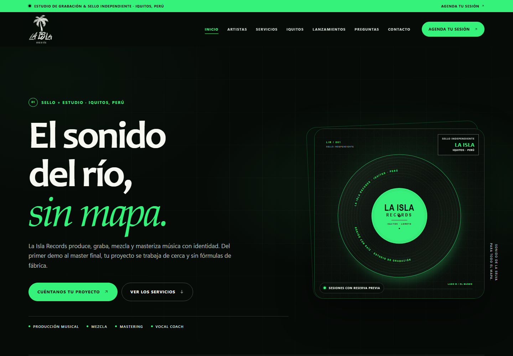

# La Isla Records — Prototipo web

Sitio estático para el sello discográfico y estudio de grabación **La Isla Records** (Iquitos, Perú). Presenta el sello, sus artistas, los servicios de estudio, la sucursal de Iquitos, el catálogo de lanzamientos, preguntas frecuentes y un formulario de contacto de demostración.



## Stack elegido

**Vanilla JavaScript: HTML, CSS y JavaScript**, sin frameworks, sin dependencias y sin proceso de compilación. Se eligió esta opción para mantener el prototipo ligero, fácil de abrir y sencillo de integrar después con el CMS o el backend que use el cliente.

No incluye backend, autenticación, pasarelas de pago ni integraciones externas.

## Cómo ejecutar

### Opción 1 — Abrir directamente

Abre `index.html` en el navegador. Todos los recursos son locales y relativos, así que funciona sin instalar nada.

### Opción 2 — Servidor local (recomendado para revisar el comportamiento completo)

Desde la carpeta del proyecto:

```bash
npx serve .
```

Abre la URL que indique la terminal (por ejemplo, `http://localhost:3000`). También puedes usar cualquier servidor estático, como la extensión Live Server de VS Code.

No hay que ejecutar `npm install` ni ningún paso de build.

## Estructura

```text
.
├── index.html              # Contenido y estructura de todas las secciones
├── css/
│   └── styles.css          # Sistema visual, componentes, responsive y accesibilidad
├── js/
│   └── main.js             # Menú móvil, scrollspy, acordeón, reveals y formulario
├── favicon.ico             # Favicon multi-tamaño en la raíz del sitio
├── assets/
│   ├── la-isla-logo.png            # Logo principal, fondo transparente
│   ├── la-isla-logo-dark.png       # Variante oscura para fondos claros
│   ├── la-isla-logo-original.jpg   # Archivo original entregado por el cliente
│   ├── favicon-64.png
│   ├── apple-touch-icon.png
│   ├── hero-record.svg
│   ├── artist-01.svg … artist-03.svg
│   └── cover-01.svg … cover-04.svg
├── preview.png             # Captura de referencia del inicio
└── README.md
```

## Secciones implementadas

- **Inicio**: hero editorial, navegación fija, CTA a servicios y a contacto.
- **La Isla**: manifiesto del sello y sus tres principios de trabajo.
- **Artistas**: tres perfiles con retratos provisionales y una convocatoria abierta.
- **Productores**: perfiles visuales de Melousooo (The Maker Money) y DJ Anxious Boy, con espacios preparados para añadir sus fotos.
- **Servicios de producción**: producción musical, mezcla, mastering, vocal coach, grabación en estudio, composición y arreglos. Cada servicio tiene descripción, beneficio principal y CTA que preselecciona el servicio en el formulario. Incluye proceso de trabajo y nota de cotización.
- **Sucursal Iquitos**: dirección, contacto, horarios, croquis referencial, indicaciones de llegada y CTA para coordinar una visita.
- **Lanzamientos**: lanzamiento destacado y tres fichas con portadas provisionales.
- **Preguntas frecuentes**: 10 preguntas en acordeón nativo (`<details>` / `<summary>`).
- **Contacto**: canales de contacto, resumen de sede y horarios, y formulario sin envío real.
- **Pie de página**: navegación secundaria, datos de sucursal y contacto.

## Datos que debe completar el cliente

Los marcadores visibles entre corchetes están pensados para reemplazarse sin tocar el diseño. Los principales son:

- **Sucursal**: `[dirección exacta de la sucursal]`, `[distrito / referencia]`, `[teléfono]`, `[WhatsApp]`, `[correo electrónico]`, `[hora de apertura]`, `[hora de cierre]`, `[horario especial]`, `[canal de reserva]`, `[condiciones para visitas]`.
- **Mapa**: `[enlace de ubicación]`; sustituir el croquis SVG por el embed o enlace real de Google Maps.
- **Artistas**: nombres, género, ciudad de origen, biografía, enlace de escucha y fotografías.
- **Lanzamientos**: nombre, artista, formato, fecha, descripción, número de catálogo y enlaces de escucha o preventa.
- **Servicios**: `[plazo estimado]`, `[revisiones incluidas]`, `[tarifa]`, `[formas de pago]` y criterios de cada propuesta.
- **Firma y derechos**: `[condiciones de firma]`, `[política de recepción]`, `[alcance de derechos y licencias]`, `[política de pago / reserva]` y `[política de cancelación]`.
- **Formulario y legal**: `[correo de demos]`, `[endpoint / CRM / correo]`, `[enlazar política de privacidad]` y datos de redes sociales.

## Conectar el formulario de contacto

El envío está desactivado a propósito. En `js/main.js`, dentro de:

```js
contactForm?.addEventListener('submit', (event) => {
  // ...
});
```

se previene el envío y se muestra un mensaje de prototipo. Para activarlo, reemplaza ese bloque por una llamada a tu endpoint (por ejemplo, `fetch`) o elimina el `preventDefault` y define el `action` real en el formulario de `index.html`. Después, actualiza la nota visible `#form-note` y el mensaje de confirmación.

## Identidad y tipografía

- **Logo principal**: se usa el arte entregado por el cliente, con fondo transparente en el encabezado y el pie. En la sección La Isla se usa la variante oscura sobre papel.
- **Favicon**: la palmera del logo sobre un cuadrado verde, generado en `favicon.ico` (raíz), `assets/favicon-64.png` y `assets/apple-touch-icon.png`.
- **Tipografía**: titulares en Candara/Optima y textos en Aptos/Segoe UI, con acentos en Palatino. Son fuentes de sistema, por lo que no hay peticiones externas ni dependencia de Google Fonts.
- **Diseño**: titulares en caja alta y baja para una lectura más cómoda, con etiquetas y CTAs en versalitas.
- El archivo original del logo se conserva en `assets/la-isla-logo-original.jpg` para futuras exportaciones.

## Accesibilidad y criterios de diseño

- Variables CSS para la paleta verde/negro en `:root` (`--verde`, `--verde-oscuro`, `--negro`, `--papel`, etc.).
- Contraste alto para textos y controles; los principales pares de color superan AA.
- Enlace para saltar al contenido, jerarquía de encabezados, landmarks semánticos y etiquetas de formulario.
- Menú móvil con `aria-expanded`, bloqueo de scroll, cierre con `Escape` y contención de foco.
- Acordeón con `<details>` nativo, operable también sin JavaScript.
- Respeto por `prefers-reduced-motion`.
- Recursos locales con textos alternativos y dimensiones declaradas.

## Personalización visual

- Paleta y tipografías: variables al inicio de `css/styles.css`.
- Retratos y portadas: reemplazar los SVG de `assets/` manteniendo las mismas proporciones (artistas 4:5, portadas 1:1).
- Los estilos están organizados por secciones y componentes dentro del mismo archivo para facilitar la revisión del prototipo.

## Alcance

Este entregable es una maqueta funcional de frontend. No procesa pagos, no guarda datos, no autentica usuarios y no publica contenido de forma dinámica. La información de contacto, horarios, artistas, lanzamientos y condiciones comerciales debe ser validada y completada por La Isla Records antes de publicar.
